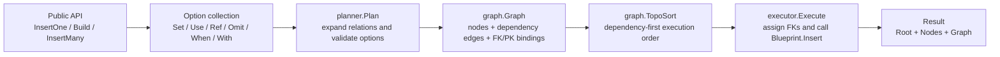
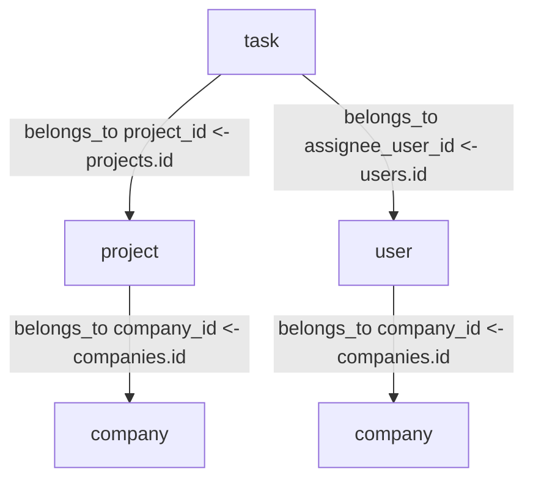
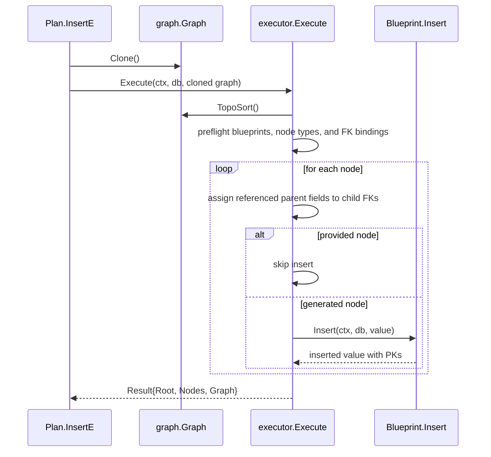
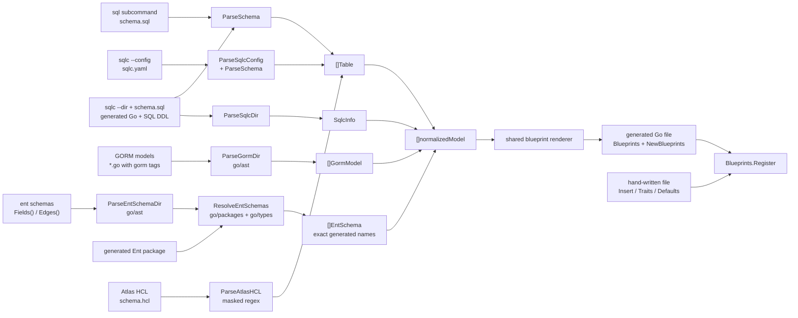

# seedling architecture

Internal design documentation explaining how seedling turns a root model plus options into inserted records. For practical usage, see the [Guide](./docs/guide.md).

## Overview

At a high level:

- `planner` decides which records must exist.
- `graph` stores those records and the PK-to-FK bindings between them.
- `executor` walks the graph in topological order, assigns FK fields, and runs inserts.

## Pipeline

### 1. Public API boundary

`BuildE[T]` resolves the root blueprint, collects options, and delegates graph construction to `internal/planner`.

Root options go through one resolution pass shared by `BuildE`, `InsertOneE`, and `InsertManyE`. Each option resolves itself into the option set of its node in written order: traits expand in place, `Ref` options resolve into the child option set of their relation against that relation's blueprint, and for `InsertMany` each record's `Seq`, `SeqRef`, and `SeqUse` become the `Set`, `Ref`, and `Use` they produce. Placement rules are checked as each option resolves — root-only options (`WithContext`, `AfterInsert`, `WithInsertLog`, `InScope`, `Only`) are rejected under `Ref`, sequence options outside `InsertMany`, and after-insert callbacks for another type — so an option behaves the same whether it is written directly or inside a trait. Options under the `Ref` of a `has_many` or `many_to_many` relation are collected first and resolved once per related record after the whole tree is known, because `Count`, `Use`, and the options of each element can come from any `Ref` or trait in the tree. Each element resolves with its index, so `At` and `Each` select their records and `Through` resolves into that element's join-record options. The resolved tree is then converted to the planner's option sets, which carry only plain node options plus one entry per collection element.

`Scenario` resolves the options of each added record the same way and hands the planner one root per record through `planner.PlanRoots`. Roots are planned in the order they were added, each with its own node namespace and no implicit sharing. A `Link` resolves to the index of an earlier root, and the expander binds that relation to the earlier root's node instead of expanding a parent; because a link can only point backwards, the combined graph stays acyclic. The graph has no single root, so results map each `Node[T]` handle to its root node ID.

Planning runs in a `Scope`, the generation environment that `Defaults` receive: named sequences, a seeded source of independent random generators, a fixed clock, and a namespace. The public API picks the scope before planning — an `InScope` option, then one bound to the `Session` or `Scenario`, then `TestScope(tb)` for the testing APIs, and finally a process-wide scope — and hands it to the registry adapter, which closes each blueprint's `Defaults` over it and offers its `Rand` as the source for `Generate` options without `WithRand`. The planner itself stays scope-agnostic and only calls the closures. Because `Defaults` and `Generate` run during planning, a plan carries the values it drew; re-executing a plan reuses them instead of drawing again. `TestScope` keys scopes by `testing.TB` and drops them in `tb.Cleanup`, deriving the namespace and seed from `tb.Name()` so one test's draws repeat across runs.

`Plan[T]` is intentionally reusable:

- `BuildE` creates the graph once.
- `InsertE` clones that graph before execution. `InsertManyE` clones its batch graph too, so every node owns the values it was built from.
- `AfterInsert` callbacks run after executor completion.
- `AfterInsert` closures are captured once at build time, so reusing a plan also reuses any callback state they hold.

### 2. Planner

The planner starts from the root blueprint and recursively expands required relations.

Inputs:

- root Go type
- registry-backed blueprint definitions
- normalized option set

Outputs:

- `graph.Graph`
- fully expanded nodes for the requested fixture
- dependency edges annotated with referenced-field/FK bindings (primary keys by default)

Core responsibilities:

- validate `Use`, `Ref`, `Omit`, `When`, and FK-related `Set`
- create a node from `Defaults`, which the public API has already bound to the plan's `Scope`
- apply root and nested options before execution; `Set` options apply in the order written
- expand `belongs_to`, `has_many`, and `many_to_many`
- lazy evaluation with `Only(...)`: skip root-level relations not in the set, building only the required subgraph
- reuse already-expanded nodes by node ID
- detect cycles during expansion: a required relation that returns to a blueprint already on the expansion stack with the same options and the same back-reference-bound relations has no finite expansion and is rejected with `ErrCycleDetected` (model self/mutual references as `Optional`). A `has_many` child whose `belongs_to` is bound to the parent that created it does not count as a revisit, so `employee -> department -> employees` expands finitely. A `Use` or `Ref` on such a bound relation is rejected, since honoring it would replace or rebuild the parent that already exists
- mark `Use(...)` relations as provided nodes so the executor skips insertion
- bind `Link(...)` relations to the node of an earlier `Scenario` root, which is inserted once and shared
- record on every node the relation that created it, and enforce `MaxNodes` as each node is added rather than after the whole graph is built

Relation expansion rules:

- `belongs_to`: expand the parent first and add an edge `parent -> child`
- `has_many`: create child nodes and bind each child back to the parent
- `many_to_many`: create the related child node plus an explicit join node; an element provided through `Use` becomes a provided node, so only its join node is inserted
- a collection relation configured per element creates one child per element; otherwise it creates `Count` children from defaults

The planner graph is dependency-oriented, so a child keeps edges to the parents it depends on.

### 3. Graph

`internal/graph` is the neutral representation between planning and execution.

Each node stores:

- blueprint name
- table name
- current value
- primary key fields
- whether the node is provided by the caller
- its origin: the node and relation that planned it, with the element index for collections, from which `Path()` derives a readable relation path such as `task.project.company`

The public `PlanSnapshot` is built from these fields in topological order, and executor insert failures carry the same path, so diagnostics never expose the opaque node IDs as the only locator.

Each edge stores one or more field bindings:

- referenced parent field (a primary key field by default)
- child FK field
- an optional converter from `Relation.Convert`, for an FK field that stores the key in another type (`sql.NullInt64`, `pgtype.Int8`, a named ID type)

This is what lets seedling support composite keys without special executor branches.

The graph must be acyclic. `TopoSort()` uses Kahn's algorithm and returns nodes in the order required for insertion.

### 4. Executor

The executor consumes a cloned graph and mutates node values during execution. Before the first insert, it resolves every blueprint and validates node types plus all FK bindings. Referenced parent fields are checked by declared type only, because a parent's `Insert` may still allocate the embedded struct that holds them; the child's own FK field is checked against its value, since nothing populates that between the check and the assignment. This preflight keeps graph-shape errors from appearing after rows have already been created.

After preflight, each node runs in topological order:

1. Read referenced values from dependency parents.
2. Assign those values into the child FK fields.
3. Skip insert when the node is provided via `Use(...)`.
4. Otherwise call the blueprint's `Insert(ctx, db, value)`.
5. Store the inserted value back on the node and in the result map, and keep a copy for cleanup so later inserts cannot change which row `Delete` receives.

Important detail:

- FK fields are not finalized by the planner.
- They are assigned by the executor immediately before each insert.
- This allows database-generated primary keys, or other returned referenced values, to flow into downstream child nodes.
- If execution stops after some inserts succeed, the executor returns those nodes with the error. Its partial graph contains only completed nodes, so `Result.CleanupE` and `BatchResult.CleanupE` never attempt to delete failed or unvisited nodes. That graph keeps the original root when the root completed and has no root otherwise, so `DebugString` never presents an arbitrary surviving node as the root.
- Binding a pointer key into a nullable `*T` FK allocates storage for the child, so a child's `Insert` writing through its FK cannot rewrite the parent's key.
- A binding with a converter is checked by both of the converter's types during preflight: the parent field must be assignable to its input, and its output to the FK field. The converter itself runs on the value the parent's `Insert` returned, so it never sees a key the database has not assigned yet. Converting is opt-in per field; there is no implicit conversion between named and underlying types.
- Cleanup walks the graph in reverse topological order and requires a `Delete` callback on every non-provided blueprint. It validates all callbacks before issuing the first delete, so a missing `Delete` surfaces as `ErrDeleteNotDefined` with no rows removed rather than as a half-finished teardown.

## Why the split exists

This separation keeps the core predictable:

- `planner` is about shape and validity.
- `graph` is about transport and ordering.
- `executor` is about runtime values and side effects.

That split also enables `DebugString()`, `DryRunString()`, `Validate()`, graph cloning, and future graph export features without entangling insertion logic.

## seedling-gen code generation pipeline

`seedling-gen` generates blueprint registration code from various schema sources. Install it with Homebrew (`brew install --cask mhiro2/tap/seedling-gen`) or `go install github.com/mhiro2/seedling/cmd/seedling-gen@latest` (see [README Installation](./README.md#-installation)). Adapters parse their inputs independently, then normalize the results into a shared intermediate representation before rendering.

The SQL and Atlas parsers first build an offset-preserving masked copy of their input in which comments, string literals (with dialect-specific syntax such as PostgreSQL dollar quotes and nested comments, MySQL backslash escapes and `#` comments, and HCL heredocs), and quoted identifiers are neutralized. Structure is matched only in that copy, while names and types are read from the original at the same offsets, so text inside a string or comment can never become a table, column, or constraint.

The SQL parser splits each source file into statements at the semicolons left in the masked copy and applies them in order to a schema state, so a migration directory yields the tables its migrations produce. The state keeps each table's columns apart from its constraints, and records every constraint under the names a later statement may use, the declared one or the name PostgreSQL or MySQL would generate. `ALTER TABLE`, `DROP`, and `RENAME` statements edit that state; `Column` flags such as `IsPK`, `IsFK`, `Unique`, and the enum values a `CHECK` allows are derived from the constraints once every statement has been applied, so dropping a constraint also clears what it implied. Columns hold the enum type itself rather than its name, so a later `ALTER TYPE ... ADD VALUE` reaches them, a type created under a reused name does not, and `DROP TYPE ... CASCADE` drops them. A declared constraint name wins over a generated one when a statement drops or renames a constraint. Each source's rollback section (goose, sql-migrate, dbmate, tern) is cut at the first marker that is a comment in the masked copy, so the same text inside a string literal does not truncate the file, and a statement whose effect cannot be followed is reported with its file and line instead of being skipped, because a silently ignored `ALTER` would generate blueprints for a schema the database no longer has.

SQL DDL, sqlc config, manual sqlc mode, and Atlas HCL still share the common `[]Table` parser output, including both local and referenced FK columns and the single-column constraints that shape generated defaults: enum values (from `ENUM(...)`, `CREATE TYPE ... AS ENUM`, or `CHECK (col IN (...))`), maximum string lengths, and uniqueness (inline, table-level, or a single-column unique index). The parser reads only these fixed shapes rather than evaluating `CHECK` expressions, and a composite unique constraint marks no column unique. GORM and ent continue to parse into adapter-specific types (`[]GormModel`, `[]EntSchema`). Ent additionally loads the generated client package and binds schema fields to its exact entity, builder, and ID signatures; this preserves project-defined entc acronyms, incorporates generated mixin fields, and rejects missing or incompatible generated signatures. Before code generation, each adapter is normalized into the same `[]normalizedModel` IR, including PK metadata (inferred keys such as GORM's untagged `ID` are excluded from defaults like explicit ones), the embedded struct that promotes a field (so defaults for `gorm.Model` fields are nested under that struct's literal), explicit referenced-field mappings, belongs-to relations, and Insert/Delete hook bodies (GORM and ent always produce a Delete hook, sqlc only when a unique `Delete<Table>` query is present, and the DDL-only SQL/Atlas adapters produce none). A shared pass then adds to every parent an optional `has_many` relation for each `belongs_to` that points at it, so the reverse side is available to tests without changing default graphs. For sqlc and GORM, another pass compares each `belongs_to` FK field type with the referenced field type and, when the FK is a known nullable wrapper of that type (`database/sql`, pgx v5 `pgtype`, or `github.com/google/uuid`), attaches a `Convert` entry. Package qualifiers are resolved through the imports of the file declaring each model rather than by name, so an aliased import still matches and an unrelated package named `sql` does not. Integer keys are converted only when the conversion is lossless, since a truncated key would silently reference another row. The final renderer is shared, so adapter-specific logic is isolated to parsing and normalization rather than duplicated template code.

Generated `Defaults` take the `*seedling.Scope` the record is planned in and derive each field's value from its type and constraints: unique columns draw `Scope.Unique` / `Scope.Seq`, enumerated columns take their first value, length-limited strings are cut to fit (unique ones through `Scope.UniqueN`), unique enums cycle through their values, UUID and JSON columns get valid values, and `time.Time` takes `Scope.Now()`. Because the scope rather than the generator supplies the varying part, regenerating never changes which values a test draws, and the generated file needs no `time` import for its defaults. The parameter name avoids every package name the file imports.

The renderer emits a single file marked `// Code generated by seedling-gen. DO NOT EDIT.` that owns only schema-derived content: model structs (SQL and Atlas), a `Blueprints` struct with one `seedling.Blueprint[T]` field per model, `NewBlueprints()`, and `Register` / `MustRegister` methods that join every registration error. Project-specific Insert/Delete callbacks, wrapped Defaults, Traits, and extra Relations live in a hand-written file of the same package that edits those fields before calling `Register`. Splitting ownership by file, rather than merging regenerated code into edited code, keeps regeneration a plain overwrite: adding a column or relation changes only the generated file, and the hand-written code keeps compiling because it addresses blueprints and fields by name. A model whose adapter cannot derive an Insert callback leaves it nil instead of emitting a stub, so `Register` fails loudly rather than reporting inserts that never reached the database. Imports are grouped as `goimports` does by default, and an adapter package whose name collides with another import (for example a sqlc package named `errors`) is rejected rather than rendered into code that cannot compile.

The same file declares `Fixtures` and one immutable typed builder per model, rendered from the normalized IR after the reverse relations are added. A builder holds the option list it accumulates and turns each typed method into the public option it stands for: field setters into `Set`, belongs-to methods into `Ref` / `Use` / `Link` taking the target model's builder, model type, or `Node`, and has-many methods into `Ref` with `Count` and one `At` per child builder. The runtime therefore stays type-erased while the generated surface rejects a wrong field, relation, or target model at compile time. Setters are emitted only for field types the generated file can name without guessing an import path; relation methods claim their names before fields, and a field whose name is already taken gets no setter.

`--check` reuses the same generation path, renders into memory, and compares the bytes with the `--out` file without writing, so CI can detect a schema change whose generated file was not refreshed.

The same normalization path also powers `seedling-gen --explain` and `--json`. Diagnostic mode emits both the parser output and the inferred blueprint summary, so relation naming, PK detection, and sqlc query matching can be inspected without reading generated code.

All parsers treat malformed input (unclosed parentheses, mismatched braces) as a hard error rather than returning partial results. When `-out` is specified, the output is written atomically via a temporary file so that a failure never leaves a partial file on disk.

## See Also

- [Guide](./docs/guide.md) -- practical workflows and API usage patterns
- [README](./README.md) -- project overview, Quick Start, and comparison table
- [pkg.go.dev API reference](https://pkg.go.dev/github.com/mhiro2/seedling) -- full type and function documentation
